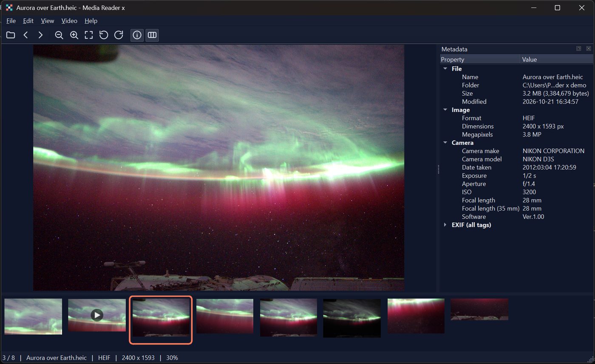
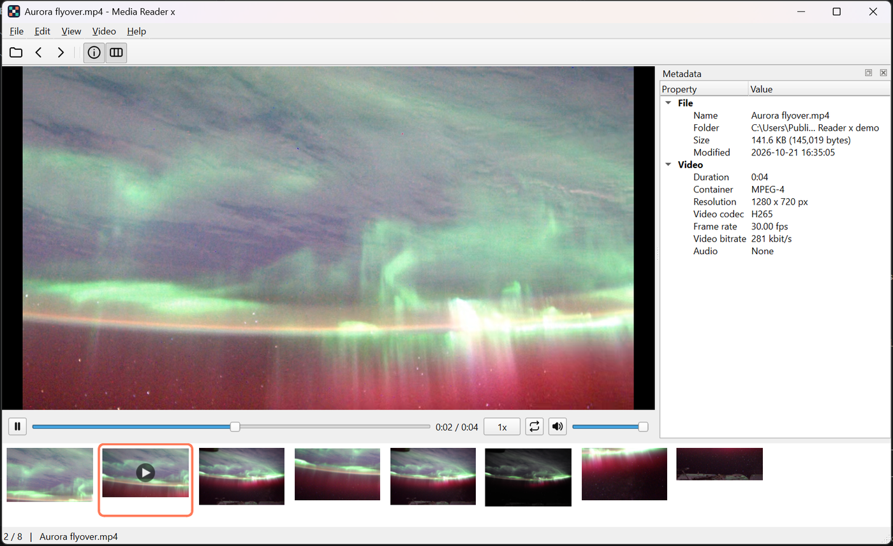
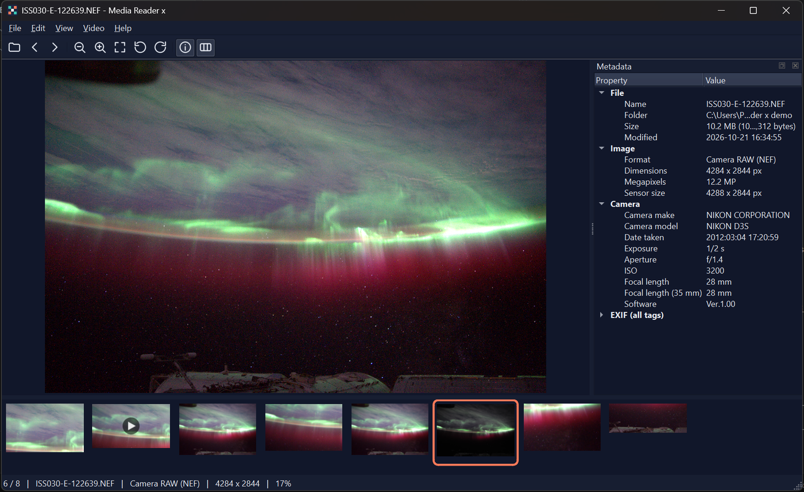
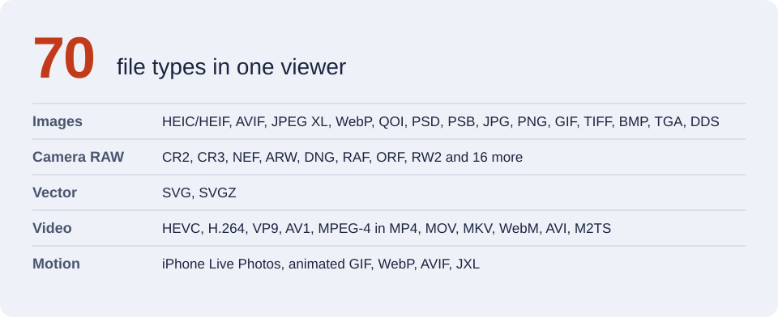
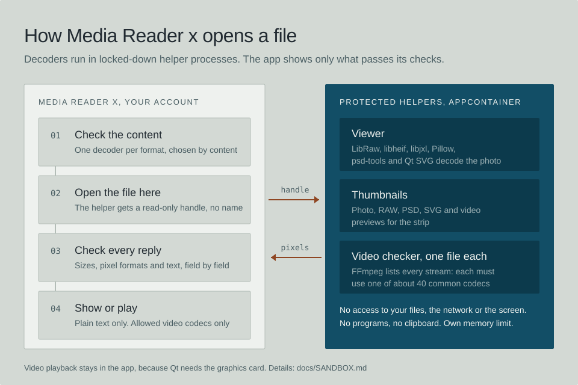

<p align="center">
  <picture>
    <source media="(prefers-color-scheme: dark)" srcset="docs/brand/hero-dark.svg">
    
  </picture>
</p>

Media Reader x is a fast, offline Windows viewer for the photo and video formats that Windows cannot open on its own: iPhone HEIC, AVIF, JPEG XL, camera RAW, Photoshop PSD, and HEVC, VP9 and AV1 video (AV1 needs a graphics chip that can decode it). It installs per user, so you need **no admin rights**. From version 1.6, every decoder runs in a locked-down helper process, so a crafted file cannot reach your other files.

<p align="center">
  
</p>

<table>
  <tr>
    <td width="50%"></td>
    <td width="50%"></td>
  </tr>
  <tr>
    <td><sub><b>HEVC video</b> plays through the app's own FFmpeg.</sub></td>
    <td><sub><b>Nikon RAW</b> (NEF) decodes with LibRaw and shows exposure, aperture and ISO.</sub></td>
  </tr>
</table>

<sub>Sample photo: NASA, ISS030-E-122639 (aurora seen from the International Space Station), public domain. The other demo files are crops and pans of the same photo.</sub>

## What it opens

<p align="center">
  <picture>
    <source media="(prefers-color-scheme: dark)" srcset="docs/brand/formats-dark.svg">
    
  </picture>
</p>

## Features

- **Browse:** instant previous and next. Neighbours preload in the background as screen-size copies, so 48 MP photos stay light on memory. Open a file or a whole folder, use the thumbnail strip with format and length badges, reopen recent files, or drag and drop.
- **View:** zoom, pan, fit, rotate, distraction-free full screen, slideshow, and a light, dark or system theme. Colours are managed (Display P3 to sRGB) and the app applies EXIF orientation.
- **Share:** copy the picture to the clipboard, or save a copy as JPG or PNG. The copy keeps the camera details and, by default, drops the location (GPS).
- **Print:** put several pictures on one A4 page with 1, 2, 4, 6 or 9 per page, Fit or Fill, margins, file names and a live preview. Save as PDF is included.
- **Tidy up:** move a file to the Recycle Bin. A Live Photo's video goes with it. On drives without a Recycle Bin (network folders, USB drives), the app does not delete, because Windows would delete permanently.
- **Video:** speed from 0.25x to 2x, loop, and seek. The app plays video with its own FFmpeg, not with the Windows video decoders, so video extensions from the Microsoft Store make no difference. AV1 plays only on a graphics chip that can decode it; if it cannot, the app says so.
- **Metadata panel:** file, camera, exposure, GPS, full EXIF, and video codec, bitrate and frame rate.
- **Private:** no network calls, no telemetry, no account. Rotate only changes the view, and Save a copy never overwrites the original. Logs hold the file type and size, never a path or a name. You can turn off "Remember recent files and folders" (File > Open recent).

## Protected decoding

<p align="center">
  <picture>
    <source media="(prefers-color-scheme: dark)" srcset="docs/brand/architecture-dark.svg">
    
  </picture>
</p>

Photo and video files are a classic way to attack a PC: a file made for a bug in a decoder can run code. Media Reader x limits what such a file can do, in layers:

1. **One decoder per file.** The app reads the first bytes and picks the one decoder for that content. Other parsers (EPS, WMF, playlists) are never used, and files that are not media are refused.
2. **Locked-down helpers.** The decoders (LibRaw, libheif, libjxl, Pillow, psd-tools, Qt SVG and FFmpeg for thumbnails and checks) run in separate processes, each in its own Windows AppContainer and job, on an empty desktop in a window station of their own. A helper gets a read-only handle to one file. It cannot read your other files, use the network, start programs, use the clipboard or see your screen. No admin rights are needed.
3. **Checked replies.** The app reads pixels and plain values from a helper, never code, and checks every size, format and string. Text from files is always shown as plain text.
4. **Short codec list for video.** A fresh helper lists a video's streams first. Only about 40 common codecs play, out of about 500 in FFmpeg. Video playback itself stays in the app, because Qt needs the graphics card.
5. **Fail closed.** Once protected decoding has worked on a PC, the app never silently goes back to unprotected decoding. Help > About shows the state, and `MediaReaderX.exe --self-test` checks it.

[docs/SANDBOX.md](docs/SANDBOX.md) has the details, including what this does not cover.

## Keyboard shortcuts

| Task | Keys |
|---|---|
| Open a file or a folder | `Ctrl+O`, `Ctrl+Shift+O` |
| Previous or next file | `Left` and `Right`, or `PgUp` and `PgDn` |
| First or last file | `Home`, `End` |
| Zoom in or out | `+`, `-` |
| Fit to window, or actual size | `F`, `1` |
| Rotate right or left | `R`, `Shift+R` |
| Full screen, slideshow | `F11`, `F5` (`Esc` leaves both) |
| Metadata panel, thumbnail strip | `I`, `T` |
| Play a Live Photo | `L` |
| Play or pause a video | `Space` or `K` |
| Seek 5 seconds, change speed | `Shift+Left` and `Shift+Right`, `[` and `]` |
| Loop, mute | `Ctrl+L`, `M` |
| Copy the picture, copy the path | `Ctrl+C`, `Ctrl+Shift+C` |
| Save a copy, print | `Ctrl+S`, `Ctrl+P` |
| Move to the Recycle Bin | `Del` |
| Show in Explorer | `Ctrl+Shift+E` |

## Install

Prebuilt installers are not published on GitHub yet. To get the app, build it from source (see [Develop](#develop)) or open an issue. The build makes a per-user `Setup.exe` and a portable zip, and neither needs admin rights. See [docs/INSTALL.txt](docs/INSTALL.txt) for the full guide, silent install and the health check.

## Develop

```powershell
# Python 3.14, installed per user (no admin)
& "$env:LOCALAPPDATA\Programs\Python\Python314\python.exe" -m venv .venv
.venv\Scripts\python -m pip install -r requirements-dev.txt
.venv\Scripts\python -m pip install --no-deps -e .
.venv\Scripts\python -m pytest            # decoders, sandbox, export, cache, navigation, GUI, video, print
.venv\Scripts\python -m mediareaderx path\to\photo.heic
```

From source, the helpers run your Python install inside the AppContainer. On the first start the app grants its own capability read access to the Python install, the virtual environment and `src`, which takes a few seconds once. To decode in the app's own process while you debug, set `MEDIAREADERX_SANDBOX=off`.

Build everything (tests, frozen app, self-test, installer, portable zip, SBOM, notices, source archives, checksums) into `dist\`:

```powershell
winget install JRSoftware.InnoSetup --scope user   # once, no admin
powershell -ExecutionPolicy Bypass -File .\build.ps1
```

<details>
<summary><b>Notes for IT and security teams</b></summary>

- **Review brief:** [docs/IT-REVIEW.md](docs/IT-REVIEW.md) is a one-page summary for an IT, security or legal review: data, network, install footprint, licences and allow-listing.
- **No elevation:** the Inno Setup installer uses `PrivilegesRequired=lowest` and installs to `%LOCALAPPDATA%\Programs\Media Reader x`. File types register under HKCU as *Open with* entries plus `RegisteredApplications`, so Windows defaults are never hijacked.
- **Protected decoding:** decoders run in AppContainer helper processes ([docs/SANDBOX.md](docs/SANDBOX.md)). The helpers are the same `MediaReaderX.exe`, started with `--sandbox-helper`. The uninstaller removes their profiles.
- **Offline and private:** no network calls and no telemetry. Logs (`%LOCALAPPDATA%\MediaReaderX\logs`, rotating, 6 x 1 MB at most) hold no paths or file names.
- **Health check:** `MediaReaderX.exe --self-test` decodes every codec headlessly, checks the content locks, and checks that a helper decodes and is contained. The exit code is 0 when everything works.
- **Supply chain:** fully pinned dependencies, a CycloneDX SBOM that lists the native libraries with CPE ids and SPDX licences, a build that stops on High or Critical CVEs (pip-audit and grype), SHA-256 checksums, and no UPX packing. The build is one-folder, so nothing unpacks into `%TEMP%`.
- **Not code-signed:** SmartScreen will warn. For a wide rollout, sign the files with a company certificate and allow them with a publisher rule. Never allow-list the user-writable install folder by path.
- **Report a vulnerability:** see [SECURITY.md](SECURITY.md).

</details>

<details>
<summary><b>Code layout</b></summary>

```
src/mediareaderx/
  app.py             bootstrap, CLI (--self-test, --log-level, --sandbox-helper, --remove-sandbox), crash handler
  formats.py         single source of truth for extensions (also drives the installer)
  content.py         content sniffing: the one decoder per file, video container and SVG checks
  sandbox/           protected decoding: helper pool and policy, Windows plumbing, message checks, the helper
  videoprobe.py      FFmpeg stream list and the video codec allow-list
  decoders.py        Pillow, pillow-heif, imagecodecs (JXL), rawpy, psd-tools, QtSvg -> QImage frames (from bytes)
  thumbnails.py      fast previews (JPEG draft, EXIF and RAW embedded previews, video frame grab)
  metadata.py        file, EXIF and GPS rows
  livephoto.py       HEIC <-> MOV pairing
  folder.py          Explorer-order folder listing and previous/next
  cache.py           memory-capped cache of decoded screen copies
  export.py          Save a copy as JPG/PNG with EXIF (GPS removed by default)
  printing.py        A4 page layout (grids, Fit/Fill, captions) for the printer, the PDF and the preview
  recycle.py         Recycle Bin check before a delete
  ui_text.py         plain-text helpers: file text is never Qt rich text
  logging_setup.py   rotating log with path redaction
  main_window.py     routing, threading, actions, settings
  widgets/           image canvas, video player (Qt Multimedia, bundled FFmpeg), metadata dock, thumbnail strip, print dialog
packaging/           PyInstaller spec, Inno Setup script, licence texts, source manifest
tools/               sample, icon, notice, SBOM, source and README art generators
```

Video plays through Qt Multimedia's bundled FFmpeg backend, not through the Windows video decoders. AV1 plays only with hardware decoding: this FFmpeg build has FFmpeg's own `av1` decoder, which needs D3D11VA, D3D12VA or DXVA2 on the GPU, and no software AV1 decoder. (dav1d ships for AVIF photos, but FFmpeg does not use it.)

</details>

## Licences and patents

- **This project's code** is MIT licensed (see [LICENSE](LICENSE)).
- **The binary** (installer and portable zip) also bundles third-party components under the LGPL, the GPL and BSD-style licences. Because x265 (GPL) ships with LGPL-3.0 libraries, the binary as a whole is conveyed under the GPL-3.0. [THIRD_PARTY_NOTICES.txt](THIRD_PARTY_NOTICES.txt) lists every component with its licence and source. The build puts the source of the GPL and LGPL components in `dist\source`, next to the installer.
- **No patent licence:** this project grants no patent licence for any codec or format (HEVC, AV1 and others). You are responsible for any licence that you or your organisation need in your country.
- **Personal project:** Media Reader x is a personal project by its author. It is not a product of the author's employer. It is provided as is, without warranty of any kind, as the MIT licence says.
