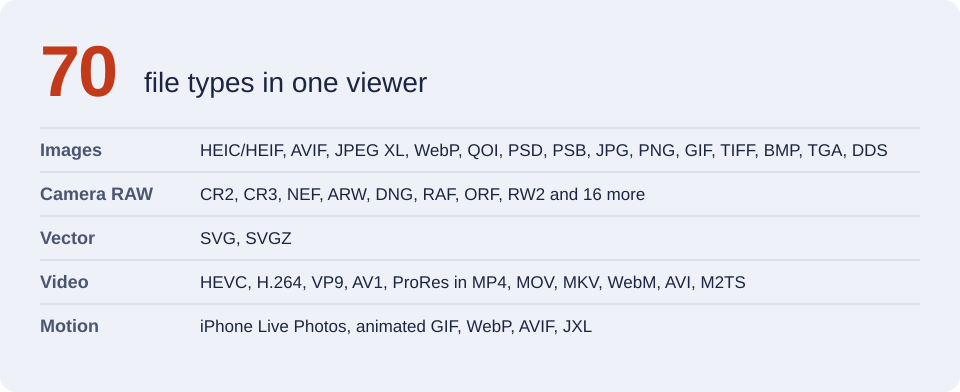

<p align="center">
  <picture>
    <source media="(prefers-color-scheme: dark)" srcset="docs/brand/hero-dark.svg">
    
  </picture>
</p>

Media Reader x is a fast, offline Windows viewer for the photo and video formats that Windows cannot open on its own: iPhone HEIC, AVIF, JPEG XL, camera RAW, Photoshop PSD, and HEVC, VP9 and AV1 video. It installs per user, so you need **no admin rights**.

<p align="center">
  
</p>

<table>
  <tr>
    <td width="50%"></td>
    <td width="50%"></td>
  </tr>
  <tr>
    <td><sub><b>HEVC video</b> plays with no Microsoft Store codec.</sub></td>
    <td><sub><b>Nikon RAW</b> (NEF) decodes with LibRaw and shows exposure, aperture and ISO.</sub></td>
  </tr>
</table>

<sub>Sample photo: NASA, ISS030-E-122639 (aurora seen from the International Space Station), public domain. The other demo files are crops and pans of the same photo.</sub>

## What it opens

<p align="center">
  <picture>
    <source media="(prefers-color-scheme: dark)" srcset="docs/brand/formats-dark.svg">
    
  </picture>
</p>

## Features

- **Browse:** instant previous and next. Neighbours preload in the background as screen-size copies, so the app uses about 170 MB of RAM even with 48 MP photos. Open a file or a whole folder, use the thumbnail strip with format and length badges, reopen recent files, or drag and drop.
- **View:** zoom, pan, fit, rotate, distraction-free full screen, slideshow, and a light, dark or system theme. Colours are managed (Display P3 to sRGB) and the app applies EXIF orientation.
- **Share:** copy the picture to the clipboard, or save a copy as JPG or PNG. The copy keeps EXIF, and you can remove GPS.
- **Print:** put several pictures on one A4 page with 1, 2, 4, 6 or 9 per page, Fit or Fill, margins, file names and a live preview. Save as PDF is included.
- **Tidy up:** move a file to the Recycle Bin. A Live Photo's video goes with it.
- **Video:** speed from 0.25x to 2x, loop, and seek.
- **Metadata panel:** file, camera, exposure, GPS, full EXIF, and video codec, bitrate and frame rate.
- **Safe by design:** rotate only changes the view, and Save a copy refuses to overwrite the original. The app makes no network calls and sends no telemetry. Logs hold the file type and size, never a path or a name.

## Keyboard shortcuts

| Task | Keys |
|---|---|
| Open a file or a folder | `Ctrl+O`, `Ctrl+Shift+O` |
| Previous or next file | `Left` and `Right`, or `PgUp` and `PgDn` |
| First or last file | `Home`, `End` |
| Zoom in or out | `+`, `-` |
| Fit to window, or actual size | `F`, `1` |
| Rotate right or left | `R`, `Shift+R` |
| Full screen, slideshow | `F11`, `F5` (`Esc` leaves both) |
| Metadata panel, thumbnail strip | `I`, `T` |
| Play a Live Photo | `L` |
| Play or pause a video | `Space` or `K` |
| Seek 5 seconds, change speed | `Shift+Left` and `Shift+Right`, `[` and `]` |
| Loop, mute | `Ctrl+L`, `M` |
| Copy the picture, copy the path | `Ctrl+C`, `Ctrl+Shift+C` |
| Save a copy, print | `Ctrl+S`, `Ctrl+P` |
| Move to the Recycle Bin | `Del` |
| Show in Explorer | `Ctrl+Shift+E` |

## Install

Prebuilt installers are not published on GitHub yet. To get the app, build it from source (see [Develop](#develop)) or open an issue. The build makes a per-user `Setup.exe` and a portable zip, and neither needs admin rights. See [docs/INSTALL.txt](docs/INSTALL.txt) for the full guide, silent install and the health check.

## Develop

```powershell
python -m venv .venv
.venv\Scripts\python -m pip install -r requirements-dev.txt
.venv\Scripts\python -m pip install --no-deps -e .
.venv\Scripts\python -m pytest            # decoders, export, cache, navigation, GUI, video, slideshow, print
.venv\Scripts\python -m mediareaderx path\to\photo.heic
```

Build everything (tests, frozen app, self-test, installer, portable zip, SBOM, checksums) into `dist\`:

```powershell
winget install JRSoftware.InnoSetup --scope user   # once, no admin
powershell -ExecutionPolicy Bypass -File .\build.ps1
```

<details>
<summary><b>Notes for IT and security teams</b></summary>

- **No elevation:** the Inno Setup installer uses `PrivilegesRequired=lowest` and installs to `%LOCALAPPDATA%\Programs\Media Reader x`. File types register under HKCU as *Open with* entries plus `RegisteredApplications`, so Windows defaults are never hijacked.
- **Offline and private:** no network calls and no telemetry. Logs (`%LOCALAPPDATA%\MediaReaderX\logs`, rotating, 5 x 1 MB) record file type and size only, never paths.
- **Hardened decoding:** 1 GB file cap, 576 MP decompression-bomb limit, and animation frame and memory caps. Decoding runs off the UI thread, and errors give plain-language messages.
- **Health check:** `MediaReaderX.exe --self-test` round-trips every codec headlessly. The exit code is 0 when everything works.
- **Supply chain:** fully pinned dependencies, a CycloneDX SBOM, SHA-256 checksums, `THIRD_PARTY_NOTICES.txt`, and no UPX packing (to avoid AV false positives). The build is one-folder, so nothing unpacks into `%TEMP%`.
- **Not code-signed:** SmartScreen will warn. For a wide rollout, sign `MediaReaderX.exe` and the installer with a company certificate (add `SignTool=` to `packaging/MediaReaderX.iss`).
- **Report a vulnerability:** see [SECURITY.md](SECURITY.md).

</details>

<details>
<summary><b>Architecture</b></summary>

```
src/mediareaderx/
  app.py             bootstrap, CLI (--self-test, --log-level), crash handler
  formats.py         single source of truth for extensions (also drives installer)
  decoders.py        Pillow + pillow-heif + imagecodecs(JXL) + rawpy + QtSvg -> QImage frames
  metadata.py        file/EXIF/GPS rows
  livephoto.py       HEIC <-> MOV pairing
  folder.py          Explorer-order folder listing and previous/next
  thumbnails.py      fast previews (JPEG draft, RAW embedded JPEG, video frame grab)
  export.py          Save a copy as JPG/PNG with EXIF (optional GPS removal)
  printing.py        A4 page layout (grids, Fit/Fill, captions) for the printer, the PDF and the preview
  theme.py           light / dark / follow Windows
  main_window.py     routing, threading, actions, settings
  widgets/           image canvas, video player (Qt Multimedia, bundled FFmpeg), metadata dock, thumbnail strip, print dialog
packaging/           PyInstaller spec, Inno Setup script
tools/               sample/icon/notice/association generators
```

Video plays through Qt Multimedia's bundled FFmpeg backend, so HEVC and AV1 work without the paid *HEVC Video Extensions* from the Microsoft Store.

</details>

## License

MIT for this project's code. The binary bundles LGPL, BSD and GPL components. See [THIRD_PARTY_NOTICES.txt](THIRD_PARTY_NOTICES.txt).
