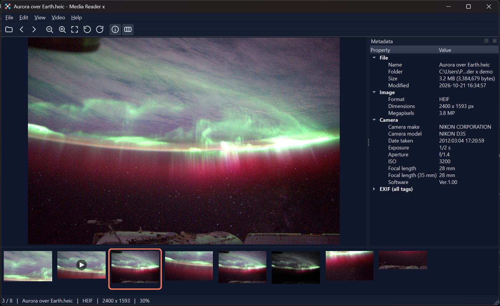
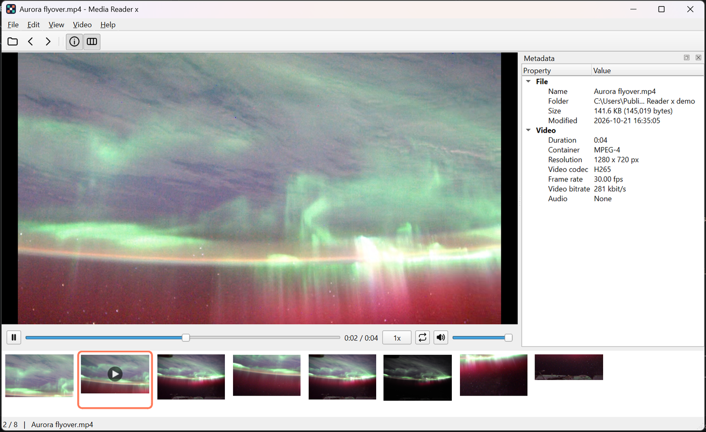
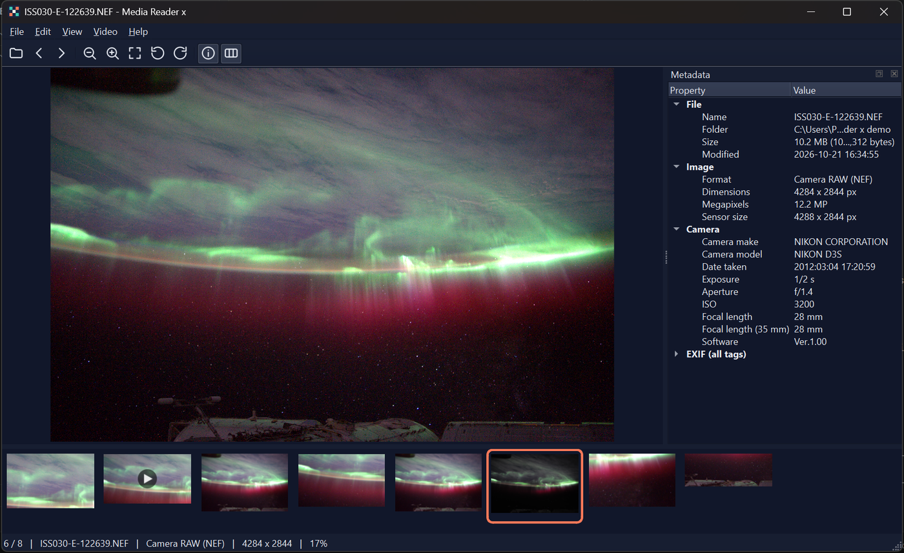

# Media Reader x

A portable, offline Windows viewer for the photo and video formats Windows can't open on its own. It installs per user, so **no admin rights** are needed.

| Family | Formats |
|---|---|
| Modern images | HEIC/HEIF (iPhone), AVIF, JPEG XL, WebP, QOI, Photoshop PSD and PSB (8, 16 and 32-bit, the flattened image Photoshop saves), plus JPG/PNG/GIF/TIFF/BMP/TGA/DDS |
| Camera RAW | CR2, CR3, NEF, ARW, DNG, RAF, ORF, RW2, PEF, SRW and more (via LibRaw) |
| Vector | SVG, SVGZ |
| Video | H.265/HEVC, H.264, VP9, AV1, ProRes, MPEG-4 in MP4, MOV, MKV, WebM, AVI, M2TS... |
| Motion | iPhone Live Photos (HEIC + MOV pair, press `L`), animated GIF/WebP/AVIF/JXL |


Features:
- **Browse:** instant previous/next (neighbours preload in the background as screen-size copies, so about 170 MB of RAM even with 48 MP photos), open a file or a whole folder, a thumbnail strip with format and length badges, recent files, and drag and drop.
- **View:** zoom, pan, fit, rotate, distraction-free full screen, slideshow (F5), and a light/dark/system theme. Colours are managed (Display P3 to sRGB) and EXIF orientation is applied.
- **Share:** copy the picture to the clipboard, or save a copy as JPG/PNG (EXIF kept, GPS optionally removed).
- **Print:** several pictures on one A4 page (Ctrl+P): Auto, 1, 2, 4, 6 or 9 per page, Fit or Fill, margins, file names, a live preview, and Save as PDF. Ctrl+click thumbnails to pick the pictures.
- **Tidy up:** move to the Recycle Bin (a Live Photo's video goes with it).
- **Video:** speed 0.25x to 2x, loop, and seek.
- **Metadata panel:** file, camera, exposure, GPS, full EXIF, and video codec/bitrate/frame rate.

## Screenshots

**An iPhone-style HEIC photo** with camera details in the metadata panel and the folder in the thumbnail strip (dark theme):



**An H.265/HEVC video** playing without any Microsoft Store codec, with speed, loop and stream details (light theme):



**A Nikon camera RAW file (NEF)** decoded with LibRaw, showing exposure, aperture, ISO and lens:



<sub>Sample photo: NASA, ISS030-E-122639 (aurora seen from the International Space Station), public domain.
The other demo files are crops and pans of the same photo.</sub>

## Install (colleagues)

Download `MediaReaderX-<version>-Setup.exe` from the shared folder or [Releases](https://github.com/xav-art/Media-reader-x/releases) and run it. See [docs/INSTALL.txt](docs/INSTALL.txt) for the full guide, the portable zip option, and IT notes such as silent install, the health check, and the SBOM.

## Enterprise notes

- **No elevation:** the Inno Setup installer uses `PrivilegesRequired=lowest` and installs to `%LOCALAPPDATA%\Programs\Media Reader x`. File types register under HKCU as *Open with* entries plus `RegisteredApplications`, so Windows defaults are never hijacked.
- **Offline and private:** no network calls and no telemetry. Logs (`%LOCALAPPDATA%\MediaReaderX\logs`, rotating, 5 x 1 MB) record file type and size only, never paths.
- **Hardened decoding:** 1 GB file cap, 576 MP decompression-bomb limit, and animation frame/memory caps. Decoding runs off the UI thread, and errors give plain-language messages.
- **Health check:** `MediaReaderX.exe --self-test` round-trips every codec headlessly. The exit code is 0 when everything works.
- **Supply chain:** fully pinned dependencies, a CycloneDX SBOM, SHA-256 checksums, `THIRD_PARTY_NOTICES.txt`, and no UPX packing (to avoid AV false positives). One-folder build, so nothing is unpacked into `%TEMP%`.
- **Not code-signed:** SmartScreen will warn. For wide rollout, sign `MediaReaderX.exe` and the installer with a company certificate (add `SignTool=` to `packaging/MediaReaderX.iss`).

## Develop

```powershell
python -m venv .venv
.venv\Scripts\python -m pip install -r requirements-dev.txt
.venv\Scripts\python -m pip install --no-deps -e .
.venv\Scripts\python -m pytest            # 142 tests: decoders, export, cache, navigation, GUI, video, slideshow, print
.venv\Scripts\python -m mediareaderx path\to\photo.heic
```

Build everything (tests, frozen app, self-test, installer, portable zip, SBOM, checksums) into `dist\`:

```powershell
winget install JRSoftware.InnoSetup --scope user   # once, no admin
powershell -ExecutionPolicy Bypass -File .\build.ps1
```

CI (`.github/workflows/build.yml`) runs the same script on every push. Pushing a `v*` tag attaches the installer to a GitHub Release.

## Architecture

```
src/mediareaderx/
  app.py             bootstrap, CLI (--self-test, --log-level), crash handler
  formats.py         single source of truth for extensions (also drives installer)
  decoders.py        Pillow + pillow-heif + imagecodecs(JXL) + rawpy + QtSvg -> QImage frames
  metadata.py        file/EXIF/GPS rows
  livephoto.py       HEIC <-> MOV pairing
  folder.py          Explorer-order folder listing and previous/next
  thumbnails.py      fast previews (JPEG draft, RAW embedded JPEG, video frame grab)
  export.py          Save a copy as JPG/PNG with EXIF (optional GPS removal)
  printing.py        A4 page layout (grids, Fit/Fill, captions) for the printer, the PDF and the preview
  theme.py           light / dark / follow Windows
  main_window.py     routing, threading, actions, settings
  widgets/           image canvas, video player (Qt Multimedia, bundled FFmpeg), metadata dock, thumbnail strip, print dialog
packaging/           PyInstaller spec, Inno Setup script
tools/               sample/icon/notice/association generators
```

Video plays through Qt Multimedia's bundled FFmpeg backend, so HEVC/AV1 work without the paid *HEVC Video Extensions* from the Microsoft Store.

## License

MIT for this project's code. The binary bundles LGPL/BSD/GPL components; see [THIRD_PARTY_NOTICES.txt](THIRD_PARTY_NOTICES.txt).
